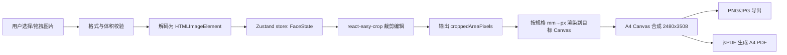

# 身份证复印件在线生成工具 开发方案文档

> **编写时间**：2026-10-14；**使用模型**：Codex；**用户**：jsmond2016

---

## 开发分支

`feature/id-card-combination-tool-online`

需求文档：`specs/id-card-combination-tool-online/id-card-combination-tool-online-需求文档.md`

---

## 方案概览

### 形态

**纯前端静态站点（SPA）**，无后端服务、无接口调用、无网络请求。所有图片处理（解码、裁剪、旋转、合成、导出）在浏览器内通过 Canvas 2D 完成。这既是需求 R13 的硬约束，也是最省成本的部署形态（静态托管即可）。

### 技术栈

| 类别 | 选型 | 用途说明 |
| ---- | ---- | -------- |
| 包管理 | pnpm 10 | 统一使用淘宝镜像（`.npmrc`） |
| 构建 | Vite 7 | 开发服务器 + 生产构建 |
| 框架 | React 19 + TypeScript（严格模式） | 函数组件 + Hooks，禁止 class 组件 |
| UI 组件 | Ant Design 5 + `@ant-design/icons` | 表单、上传、滑块、布局组件 |
| CSS | Tailwind CSS 4（Vite 插件） | 布局与间距工具类 |
| Hooks | ahooks 3 | `useSetState`、`useMemoizedFn`、`useBoolean`、`useEventListener` |
| 函数式 | Ramda（+ `@types/ramda`） | 状态与版式数据的不可变变换 |
| 状态管理 | Zustand 5 | 单一 store，承载图片、编辑参数、版式与导出设置 |
| 裁剪组件 | `react-easy-crop` | 锁定宽高比的裁剪框，支持缩放与旋转 |
| PDF 导出 | `jsPDF` | 生成精确 A4 尺寸的单页 PDF |
| 代码质量 | ESLint 9（flat config）+ Prettier 3 | 静态检查与格式化 |

### 数据流



关键点：`croppedAreaPixels` 只是**裁剪区域描述**，不作为最终像素输出。最终输出统一由"A4 合成阶段"按规格毫米尺寸 × DPI 反算像素，避免裁剪框缩放倍率导致的输出尺寸漂移（对应 R6）。

---

## 需求-方案映射

状态取值：`待确认` / `已确认` / `已实现` / `已验证`

| 需求 ID | 开发方案 | 影响范围 | 验证方式 | 状态 |
| ------- | -------- | -------- | -------- | ---- |
| R1 | `UploadPanel` 使用 `Upload.Dragger` + `beforeUpload` 返回 `false`；`utils/image.validateImageFile` 做扩展名/MIME 双校验与 20MB 上限；上传成功后写入 store 并同步生成默认裁剪 | `components/UploadPanel.tsx`、`hooks/useFaceEditor.ts`、`utils/image.ts` | 逻辑断言覆盖 jpg 通过 / txt、超限、空文件被拒；浏览器实测上传成功 | 已实现 |
| R2 | 与 R1 共用 `UploadPanel`，通过 `kind` 属性区分正反面，store 中维护两个独立 `FaceState` | `components/UploadPanel.tsx`、`stores/useIdCardStore.ts` | 浏览器实测正反面各自上传成功、互不覆盖 | 已验证 |
| R3 | 版式以 `kinds`（实际参与排版的面位数组）驱动分组计算，面位缺失时不预留占位 | `utils/geometry.ts` | 单面时分组高度为 56mm 且垂直居中（断言）；浏览器实测单面/双面均正常 | 已验证 |
| R4 | `FaceCard` 提供「重新上传」（Upload 包装按钮）与「移除」（`Popconfirm` 二次确认），移除时释放图片缓存 | `components/FaceCard.tsx`、`stores/useIdCardStore.ts` | 代码路径完整；无自动化交互验证 | 已实现 |
| R5 | `CropEditor` 基于 `react-easy-crop`：`aspect = 规格宽/高`；缩放滑块；整角 ±90° 按钮；细调滑块 ±45°（步进 0.1°）；`objectFit="contain"`；`onCropComplete` 以 `isValidCropArea` 拦截 NaN；渲染层缺裁剪时回退 `computeDefaultCrop` | `components/CropEditor.tsx`、`utils/image.ts`、`utils/renderFace.ts`、`stores/useIdCardStore.ts` | `pnpm verify:crop` 覆盖上传 → 拖动 → 放大 → 旋转微调 → 右转 90° → 复位 → 关闭弹窗 8 个阶段，断言 A4 与面位预览始终有画面、裁剪区域始终为有限正数 | 已验证 |
| R6 | `constants/idCard.ts` 定义 `SPEC_PRESETS`、`mmToPx`、`dpiToPxPerMm`；输出画布尺寸由毫米 × DPI 推导，UI 不暴露自由尺寸 | `constants/idCard.ts`、`utils/renderA4.ts` | 断言：A4@300DPI=2480×3508、88×56@300DPI=1039×661；浏览器实测 PDF 页面为 210 × 297mm | 已验证 |
| R7 | `utils/geometry.buildLayoutPlan` 纯函数在毫米空间计算分组与坐标，正反面间距由 `layout.gapMm` 驱动（默认 `DEFAULT_FACE_GAP_MM` = 10mm，异常值回退默认）；`LayoutPanel` 提供版式/对齐/份数/间距控件 | `utils/geometry.ts`、`components/LayoutPanel.tsx`、`stores/useIdCardStore.ts`、`types/idCard.ts` | 断言覆盖上下/左右排列坐标、间距 10/20/0/NaN 四种取值、距边对齐、溢出标记；浏览器实测修改间距后 A4 预览的实际像素间隔随之变化（默认实测 9.69mm、改为 25mm 后实测约 24.9mm） | 已验证 |
| R8 | `A4Preview` 以 Pointer Events 实现拖动，位移换算为毫米写入 `face.offset`；`LayoutPanel` 提供 X/Y `InputNumber`（步进 0.5mm）与「复位位置」；越界经 `clampFacePosition` 钳制 | `components/A4Preview.tsx`、`utils/geometry.ts` | 断言：偏移生效且尺寸不变、越界钳制到 [5, 217]/[5, 236]；拖动交互未自动化验证 | 已实现 |
| R9 | `buildLayoutPlan` 支持 `copies: 1 \| 2`，多份沿纵向以 `copyGap` 叠放并整体垂直居中 | `utils/geometry.ts`、`components/LayoutPanel.tsx` | 断言：2 份内容高 244mm、四个面位坐标互不重叠；浏览器实测 2 份后着色像素约翻倍 | 已验证 |
| R10 | `canvasToBlob` + `downloadBlob`；A4 画布像素由 `dpiToPxPerMm` 决定 | `utils/export.ts`、`hooks/useExport.ts` | 浏览器实测导出的 PNG 为 2480 × 3508 | 已验证 |
| R11 | `jsPDF({ unit: 'mm', format: 'a4' })` + `addImage(dataUrl, 'JPEG', 0, 0, 210, 297)`，动态 `import` 拆分出独立 chunk | `utils/export.ts`、`hooks/useExport.ts` | 浏览器实测 PDF `MediaBox = [0 0 595.28 841.89]`，即 210 × 297mm | 已验证 |
| R12 | `PrintTips` 常驻提示与 FAQ；`LayoutPanel` 提供「打印校准尺」开关（默认关闭），开启时在 A4 底部绘制 50mm 标尺 | `components/PrintTips.tsx`、`utils/renderA4.ts` | 界面实测渲染正常；标尺未做打印实物量测 | 已实现 |
| R13 | 全站不引入任何请求库；`beforeUpload` 返回 `false` 阻止 antd 内置上传；无 `fetch`/`XHR` 调用 | 全局 | 浏览器实测启用 Network 域采集全流程请求：除本地开发服务器外无任何跨域请求 | 已验证 |
| R15 | `validateImageFile` 对 HEIC/HEIF 给出专属提示；`estimateEffectiveDpi` 反算有效精度，低于 300 DPI 时在 `FaceCard` 显示告警标签；FAQ 覆盖非身份证比例与拍摄建议 | `utils/image.ts`、`components/FaceCard.tsx`、`components/PrintTips.tsx` | 断言：HEIC 提示文案、低分辨率判据；界面告警渲染未自动化验证 | 已实现 |
| R16 | antd `Row/Col` 栅格 + Tailwind 响应式前缀；异步操作使用 `App.useApp()` 消息反馈与按钮 loading；窄屏约束见「关键实现细节 §10」（固定最小宽度一律写成 `min(值, 100%)`） | `pages/HomePage.tsx`、各组件、`src/index.css` | 浏览器实测 320 / 360 / 390px 视口下整页与裁剪弹窗均无横向滚动、卡片标题未被截断（`verify:e2e` 移动端回归）；另在 240–1920px 全宽度扫描与根字号 16–24px 扫描中确认整页无横向溢出 | 已验证 |
| R17 | `ExportPanel` 提供 150 / 300 DPI 分段控件，默认 300 | `components/ExportPanel.tsx`、`constants/idCard.ts` | 断言：150 DPI 时 A4 = 1240 × 1754；300 DPI 已浏览器实测 | 已验证 |
| R18 | `buildFileName(extension, now?)` 生成 `身份证复印件_YYYYMMDD_HHmm.ext` | `utils/export.ts` | 断言：固定时间下输出 `身份证复印件_20261014_0905.pdf` | 已验证 |
| R19 | `A4Preview` 用 CSS flex 排布「上/左标尺 + 纸张画布 + 参考线叠加画布」；标尺刻度与高亮区间用百分比定位，随预览尺寸自适应；拖动时 `utils/alignment.resolveSnap` 在毫米空间计算吸附位置与参考线，参考线画在独立的叠加画布上（`pointer-events: none`），避免污染导出画布 | `components/A4Preview.tsx`、`utils/alignment.ts`、`stores/useIdCardStore.ts` | 断言覆盖吸附到页面中心 / 安全边距 / 另一面位边缘、超阈值不吸附、阈值可覆盖为 0；浏览器实测真实鼠标拖拽后 `offset` 精确落在参考线上（横向 -51mm → 左边缘 10mm、纵向 +61mm → 上边缘 148.5mm），拖拽中叠加画布有参考线像素、松开后清零，关闭开关后标尺不再占位 | 已验证 |
| R20 | `utils/watermark.ts` 纯函数：`normalizeWatermarkText`（折叠空白 + 按码点截断 15 字）、`estimateTextWidthMm` / `estimateTextHeightMm`（宽度与行高估算）、`computeWatermarkLayout`（覆盖外接圆的瓦片坐标）、`resolveWatermarkDrawParams`（参数钳制 + 可绘制性判定）与绘制函数 `drawWatermark`；`composeA4Canvas` 在面位之后、校准尺之前调用；`WatermarkPanel` 提供开关、文字输入（`maxLength` 15 + `showCount`）与字号 / 间距 / 角度三个滑块；`WatermarkSettings` 存入 Zustand store（TD17–TD19） | `utils/watermark.ts`、`utils/renderA4.ts`、`components/WatermarkPanel.tsx`、`stores/useIdCardStore.ts`、`types/idCard.ts`、`constants/idCard.ts` | 断言覆盖文字折叠与截断、宽度 / 行高估算、瓦片步进与四角覆盖、密度单调性、参数钳制、空文字与超小画布不绘制、瓦片数量上界；浏览器实测 UI 开关与输入联动、启用后白边出现墨迹、密度 / 角度 / 字号改动都会改变预览墨迹、关闭后墨迹归零 | 已验证 |
| R21 | `constants/project.ts` 集中存放 `PROJECT_AUTHOR` / `PROJECT_REPO_URL` / `PROJECT_REPO_LABEL`；`AppFooter` 用 antd `Typography.Link` 渲染普通 `<a target="_blank" rel="noopener noreferrer">`，由 `HomePage` 挂在栅格 `Row` **之外**的容器末尾（避免受 A4 预览列 `sticky` 影响） | `constants/project.ts`、`components/AppFooter.tsx`、`pages/HomePage.tsx` | 断言：作者非空、仓库地址为 HTTPS 的 GitHub 地址、展示用短地址与真实地址一致；浏览器实测页脚文案含作者、链接 `href` / `target` / `rel` 正确、页脚内无 `img` / `script` / `iframe`，且全流程仍无第三方请求 | 已验证 |
| R22 | 新增 `utils/rectify.ts` 纯函数模块：`createDefaultQuad`（默认四角）、`constrainQuadCorner`（凸性约束，结构性排除自交）、`isValidQuad`（有限性 / 界内 / 凸性 / 面积校验）、`resolveHomography`（高斯消元解 8 元方程组）、`warpQuadToPixels`（逐像素反向映射 + 双线性插值）、`applyEdgeOffset`（边缘微调）、`resolveCardRect`（卡面真实比例居中补白）、`renderRectifiedFace`（canvas 层封装 + 采样源降采样与缓存）；`renderFaceCanvas` 在 `rectify.enabled` 时改走矫正链路；`CropEditor` 顶部新增「矩形裁剪 / 透视矫正」分段控件，矫正模式渲染 `PerspectiveEditor`（SVG 四点手柄 + 暗化遮罩 + 边缘微调滑块），`FaceState` 新增 `rectify` 字段（TD20–TD23） | `utils/rectify.ts`、`utils/renderFace.ts`、`components/CropEditor.tsx`、`components/PerspectiveEditor.tsx`、`stores/useIdCardStore.ts`、`hooks/useFaceEditor.ts`、`types/idCard.ts`、`constants/idCard.ts` | `pnpm verify:logic` 新增 31 项断言（100 → 131）：单应矩阵映射误差 < 1e-6、矩形四角逐像素等价于原图裁剪、**斜拍梯形矫正后背景像素为 0**、四角与对角线交点落位、退化四边形被拒、凸性约束不误挡合法梯形、边缘微调面积与钳制、卡面补白尺寸；`pnpm verify:rectify` 6/6：整幅裁剪桌面色 23778 → 贴合裁剪 8902 → 矫正后 **0**，卡面内容 24306 仍在 | 已验证 |

---

## 技术决策

| ID | 决策 | 理由 | 备选方案与否决原因 |
| -- | ---- | ---- | ------------------ |
| TD1 | 纯前端、零上传，不引入任何请求库 | 身份证是最高敏感级个人信息，上传即产生存储、传输、留存三类风险；R13 为硬约束 | 后端处理：需要服务器、带来合规成本，且对纯图像排版无技术必要性 |
| TD2 | 以 **mm 为唯一真值**，像素由 `dpi` 派生；所有坐标计算在毫米空间完成后统一 `Math.round` 到像素 | 打印正确性本质是毫米正确性；若在像素空间累加会因取整产生漂移，2 份叠放时误差会被放大 | 直接按像素布局：DPI 切换时需重算全部常量，易错 |
| TD3 | 规格预设各自定义 `widthMm/heightMm`，裁剪框宽高比与输出尺寸都取该预设自身比例，不做等比缩放折算 | 用户要"符合标准或略小"，两个预设都是行业硬值；等比重算会让输出落在 88×55.5 这类非标尺寸上 | 只保留 88×56 并等比缩放：输出高度非标 |
| TD4 | 裁剪结果不落中间画布：把「旋转 → 裁剪 → 缩放」合成为**一次仿射变换**直接画到目标尺寸画布；`croppedAreaPixels` 位于旋转后的原图坐标系，按 `目标坐标 = (旋转后坐标 − crop 起点) × 缩放比` 映射 | 省掉与原图等大的中间画布（12MP 手机图单张可达约 50MB），移动端不会因每帧重绘而 OOM；同时天然保证输出像素 = 规格 × DPI | ①先生成旋转中间画布再裁剪：每帧分配 GB 级内存，拖动即卡顿；②先生成裁剪位图再缩放：多一次大图绘制与二次插值损失 |
| TD5 | PDF 采用 `jsPDF({ unit: 'mm', format: 'a4' })`，`addImage` 按 `(0, 0, 210, 297)` 铺满；嵌入 JPEG（quality 0.95） | 页面尺寸写入 PDF 物理单位，100% 打印即真实尺寸；JPEG 相比 PNG 显著减小文件体积 | 用图片直接打印：浏览器会按"适合页面"缩放，尺寸不可控 |
| TD6 | Tailwind 4 与 antd 5 采用 `@layer theme, base, antd, components, utilities` 分层 + `StyleProvider layer` | 官方推荐做法，使 antd 样式固定在 `antd` 层、Tailwind 工具类始终可覆盖它，避免 preflight 重置破坏 antd 组件 | 关闭 preflight：仍需手工补 `border-style` 等基础样式 |
| TD7 | 不引入 React Router / TanStack Query / axios | 单页工具、无服务端状态，引入后只增加体积与心智负担 | 按脚手架模板全量安装：无使用的依赖属于负资产 |
| TD8 | 仅支持平面旋转（整角 + 细调），不实现透视矫正 | 透视矫正在 Canvas 2D 下需逐像素重映射或引入 WebGL/CV 依赖，成本远超收益；通过拍摄引导规避 | 引入 opencv.js：体积约 8MB，破坏"轻量在线工具"定位（已列为非目标） |
| TD9 | EXIF 方向交由浏览器原生处理（`` 解码，现代浏览器自动应用方向标记） | 手机拍摄图带 Orientation 标记，浏览器渲染与 `drawImage` 均已按方向输出，无需引入 `exif-js` | 手工解析 EXIF：重复实现且易漏 case |
| TD10 | "每页 2 份"沿**纵向叠放**两组，而非左右并列 | 纵向叠放不改变既有分组内部版式，只需平移 `groupHeight + copyGap`，逻辑复用度最高 | 左右并列：需额外定义两组的水平对齐规则，且横向易超 A4 宽度 |
| TD11 | Zustand 单 store 管理跨组件状态；`patchFace` 采用**浅合并**（`Partial<FaceState>`），嵌套对象（`offset`、`croppedAreaPixels`）整体传入；Ramda 只用于纯数据变换（`clamp`、`fromPairs`） | 编辑参数与图片状态需要跨组件共享（上传面板、裁剪器、A4 预览、导出面板），单 store 避免多层回调透传；嵌套对象整体传入可由类型系统拦截"只传半个 offset"的写法，避免旧字段残留造成状态污染 | 深合并（`mergeDeepLeft`）：类型上无法约束"半截嵌套对象"，只更新 `offset.xMm` 会静默沿用旧 `yMm`，状态污染难以察觉 |
| TD12 | `croppedAreaPixels` 只作为"裁剪区域描述"，最终像素在渲染阶段按规格毫米 × DPI 反算 | 直接使用裁剪位图会带上用户的缩放倍率，输出尺寸随缩放漂移（违背 R6） | 直接导出裁剪位图：尺寸不可控 |
| TD13 | 上传成功后立即用 `computeDefaultCrop` 写入一份按规格比例的默认裁剪区域 | `react-easy-crop` 只在编辑器挂载时才产生 `croppedAreaPixels`，若不预置，用户不打开编辑器就看不到 A4 预览 | 依赖编辑器回调：未打开编辑器时预览空白 |
| TD14 | 正反面间距默认 **10mm**（`DEFAULT_FACE_GAP_MM`），并存于 `layout.gapMm` 供用户按 2–30mm 调节 | GB 11643 / ISO 7810 ID-1 只规定身份证卡体为 85.6 × 54mm，**未规定复印件上正反面的间距**；调研市面同类工具（lettimepassby/idcard-print 的 `gap_mm`、Swkings/photo-cut-merge 的 `--doc-gap-mm`）默认值均为 10mm，故取 10mm 为默认并把调节权交给用户 | 沿用固定 6mm：无任何来源支撑，且用户无法针对不同受理方要求调整 |
| TD15 | 拖拽吸附在**毫米空间**做，参考线来自三类锚点：页面中心线、安全边距线、其它面位的「起始边 / 中心 / 结束边」；阈值 `SNAP_THRESHOLD_MM = 2.5`，每个轴向只取距离最近的一条参考线 | 毫米是版式的唯一真值（TD2），吸附写在毫米空间才能保证「吸上去就是精确值」，且可以在 Node 中直接断言；三类锚点覆盖了用户实际会关心的对齐需求（居中、贴边、两面对齐） | 只在像素空间做吸附：受预览缩放影响，同一段代码在不同屏幕宽度下吸附结果不同，也无法脱离浏览器断言 |
| TD16 | 参考标尺与参考线均为**纯预览层**：标尺用 DOM（CSS flex + 百分比定位），参考线画在叠加画布上，纸张画布与导出链路完全不感知 | 参考标尺/参考线一旦画进纸张画布就会出现在导出文件里；分层实现后导出结果与是否开启标尺无关 | 画在纸张画布上再擦除：导出时机与重绘时序耦合，容易漏擦 |
| TD17 | 水印在**页面合成阶段**绘制：`composeA4Canvas` 内、面位之后、校准尺之前，与身份证图像共用同一条渲染链路 | 预览与导出共用 `composeA4Canvas`（TD2 的延伸），把水印画进这个函数，预览即所得、导出与预览天然一致；画在面位之后保证水印压在身份证图像**之上**，无法靠裁剪图片本身去掉 | ①画在面位画布上：水印被卡片边界裁掉，还会跟着卡片一起被拖动；②导出时另画一层：出现两条绘制路径，预览与导出必然漂移 |
| TD18 | 水印平铺在**毫米空间**按「覆盖页面外接圆」计算瓦片，绘制时整体绕页面中心旋转 `angleDeg`；文本宽度按字符类型估算（全宽字符 = 1 倍字号、半角 = 0.6 倍字号），行高 = 1.2 倍字号 | 任意旋转角下「覆盖外接圆」必然覆盖整页矩形，无需按角度分类讨论；宽度估算让布局与浏览器字体度量解耦，同一输入可在 Node 中直接断言（无需 canvas） | 用 `measureText` 实时测量：布局依赖浏览器字体度量，脱离浏览器无法断言，且 Web 字体加载前后宽度会变 |
| TD19 | 水印参数在**状态写入与绘制两处**守卫：store 写入时按码点截断到 15 字并折叠空白；绘制时把字号 / 间距 / 角度钳制到合法区间，`pxPerMm` 或字号异常时直接跳过绘制 | 水印是可选功能，参数一旦为 `NaN` / 越界 / 极值，轻则整页绘制失败，重则几十万个瓦片把浏览器拖死；钳制后瓦片数量有确定上界（实测最密配置 < 400 个） | 只在 UI 层限制取值范围：`InputNumber` 清空后回传 `null`，仍会写入非法值 |
| TD20 | 透视矫正采用「用户手动标定四角 + 单应变换」，**不引入任何 CV / WebGL 依赖** | 只有"自动找四个角"才需要 CV 依赖；拿到四角之后，矫正本身只是一个 8 元线性方程组加一次重采样，几十行纯函数即可完成，且能在 Node 中直接断言 | ①引入 opencv.js（约 8MB）：违背"轻量在线工具"定位，且仅用于自动找角；②WebGL shader 做单应：多出一条渲染路径，预览 / 导出 / 测试成本都显著上升 |
| TD21 | 单应矩阵按**「目标矩形 → 源四边形」**方向求解（避免再求逆），逐像素**反向映射** + 双线性插值；采样点落在源图之外时填纯白 | 反向映射遍历的是目标像素，复杂度只与输出尺寸相关、与 12MP 源图无关；采样点落在四边形之外即代表"卡片之外的内容"，**背景不是被擦除，而是根本不会被采样到**，这是背景零残留的机制 | 把四边形切成两个三角形用仿射变换近似：斜边会留下可见接缝，且需要在 canvas 上跑，脱离浏览器无法断言 |
| TD22 | 采样源在渲染时先降到 `min(源尺寸, 2 × 卡面目标尺寸)` 再取像素；预览级（≤ 4M 像素）按 `objectUrl + 尺寸` 缓存（LRU ≤ 4 条，`releaseImage` 时清空），导出级不缓存 | 12MP 原图的 `ImageData` 约 48MB，而逐像素反演本就只按输出采样，2 倍目标尺寸即可满足 300 DPI 采样精度：内存从 48MB 降到 11MB（导出）/ 0.5MB（预览），同时保留下采样带来的抗锯齿收益 | 直接对原图 `getImageData`：内存峰值与首次绘制耗时都不可控，手机上尤其危险 |
| TD23 | 矫正结果按「卡面真实比例 85.6 × 54mm 居中 + 规格内补白」绘制；「边缘微调」在**渲染时**施加，不改写用户标定的四角 | 88 × 56 比卡体每边大 1.2mm / 1.0mm，真实复印机在玻璃上复印卡片时卡外本就是白纸；按真实比例居中既复现这一观感，又避免 88/56 与 85.6/54 之间 0.87% 的比例压缩。边缘微调只作用于渲染，用户标定的锚点始终可回退 | ①拉伸铺满画布：产生 0.87% 比例压缩且丢失真实的白色卡边；②把边缘微调写回 store：会不可逆地破坏用户标定的四角 |

---

## 模块与文件规划

```text
.
├── specs/id-card-combination-tool-online/    # 需求文档与开发方案文档（本目录）
├── docs/                                     # 使用说明等辅助文档
├── public/                                   # 静态资源
├── scripts/                                  # 验证脚本（逻辑断言 + 浏览器端 E2E）
└── src/
    ├── main.tsx                  # 入口：ConfigProvider / StyleProvider / App 消息上下文
    ├── App.tsx                   # 应用外壳（单页工具，无路由）
    ├── index.css                 # Tailwind 分层引入 + 少量全局样式
    ├── constants/idCard.ts       # 规格预设、A4 尺寸、DPI 选项、mmToPx
    ├── constants/project.ts      # 项目署名与仓库地址（页脚数据源）
    ├── types/idCard.ts           # FaceKind / FaceState / LayoutSettings / ExportSettings
    ├── stores/useIdCardStore.ts  # Zustand store：faces、layout、exportSettings
    ├── hooks/
    │   ├── useProject.ts         # 聚合派生状态：预设、版式计划、A4 合成函数
    │   ├── useFaceEditor.ts      # 单面位编辑动作与校验（上传、移除、有效精度）
    │   └── useExport.ts          # 导出流程编排（loading、错误提示、下载）
    ├── utils/
    │   ├── geometry.ts           # 版式纯函数：分组尺寸、坐标、溢出钳制
    │   ├── alignment.ts          # 拖拽吸附：参考线锚点、吸附位置计算
    │   ├── image.ts              # 文件校验、解码、旋转包围盒、裁剪重采样
    │   ├── renderFace.ts         # 把单个面位渲染为规格尺寸画布
    │   ├── rectify.ts           # 透视矫正：单应矩阵、逐像素反向映射、边缘微调、卡面补白
    │   ├── watermark.ts          # 水印：文字规范化、宽度估算、平铺瓦片计算与绘制
    │   ├── renderA4.ts           # A4 Canvas 合成、校准标尺
    │   └── export.ts             # PNG/JPG/PDF 导出、文件名、下载
    ├── components/
    │   ├── AppHeader.tsx         # 标题、隐私标识、重置
    │   ├── AppFooter.tsx         # 页脚：项目作者与仓库地址
    │   ├── PrivacyNotice.tsx     # 本地处理说明
    │   ├── FieldRow.tsx          # 设置项标签 + 控件的统一排版
    │   ├── UploadPanel.tsx       # 空状态上传入口（点击/拖拽）
    │   ├── FaceCard.tsx          # 面位卡片：成品预览、重传、移除
    │   ├── FaceOutputPreview.tsx # 面位"成品效果"预览画布
    │   ├── CropEditor.tsx        # react-easy-crop 裁剪编辑区
    │   ├── PerspectiveEditor.tsx # 透视矫正：四点定位手柄 + 暗化遮罩 + 边缘微调
    │   ├── LayoutPanel.tsx       # 规格、版式、对齐、份数、位置微调
    │   ├── WatermarkPanel.tsx    # 水印开关、文字、大小 / 密度 / 角度
    │   ├── A4Preview.tsx         # A4 预览（可拖动微调面位）
    │   ├── ExportPanel.tsx       # 格式、DPI、导出按钮
    │   └── PrintTips.tsx         # 打印须知与常见问题
    └── pages/HomePage.tsx        # 主页面：三栏工作区编排
```

> 与初版方案的偏差（已同步）：
>
> - 未新建 `hooks/useA4Preview.ts`：A4 预览的重绘逻辑内聚在 `components/A4Preview.tsx` 的 effect 中，单独抽 hook 只会增加一层无收益的间接。
> - 未新建 `utils/notify.ts`：统一改用 antd `App.useApp()` 提供的 `message` 实例，避免静态方法脱离 `ConfigProvider` 上下文。
> - 新增 `hooks/useProject.ts`：把预设、版式计划、合成函数聚合成单一模型，供预览、导出与设置面板共用同一份真值。
> - 新增 `utils/renderFace.ts` 与 `components/FaceOutputPreview.tsx`：裁剪编辑器与面位卡片都需要"按规格渲染的成品预览"。

---

## 关键实现细节

### 1. 毫米与像素换算

```ts
export const A4 = { widthMm: 210, heightMm: 297 } as const;
export const mmToPx = (mm: number, dpi: number) => Math.round((mm / 25.4) * dpi);
```

| 目标 | 计算 | 结果 |
| ---- | ---- | ---- |
| A4 @300DPI | `210/25.4*300` × `297/25.4*300` | 2480 × 3508 px |
| A4 @150DPI | 同上按 150 | 1240 × 1754 px |
| 88×56mm @300DPI | `88/25.4*300` × `56/25.4*300` | 1039 × 661 px |
| 85.6×54mm @300DPI | `85.6/25.4*300` × `54/25.4*300` | 1011 × 638 px |

### 2. 裁剪区域重采样（消除尺寸漂移）

1. 设源图尺寸 `W0 × H0`，总旋转角 `θ = quarterTurns × 90 + fineRotation`。
2. 计算旋转后包围盒：`Wb = |W0·cosθ| + |H0·sinθ|`，`Hb = |W0·sinθ| + |H0·cosθ|`（**注意**：`croppedAreaPixels` 的坐标系基于旋转后的图像，与 react-easy-crop 内部一致）。
3. 新建目标画布，尺寸为规格像素尺寸 `Wt × Ht`，先铺白底。
4. 把「旋转 → 裁剪 → 缩放」合成为**一次仿射变换**直接绘制源图，缩放比 `sx = Wt / crop.width`、`sy = Ht / crop.height`：

```ts
ctx.imageSmoothingEnabled = true;
ctx.imageSmoothingQuality = 'high';
ctx.translate(-crop.x * sx, -crop.y * sy); // 裁剪起点移到画布原点
ctx.scale(sx, sy); // 缩放比作用到后续绘制
ctx.translate(Wb / 2, Hb / 2); // 对齐旋转包围盒中心
ctx.rotate((θ * Math.PI) / 180); // 旋转
ctx.translate(-W0 / 2, -H0 / 2); // 对齐源图中心
ctx.drawImage(image, 0, 0);
```

5. 该写法与"先渲染整张旋转图再裁剪"完全等价，但不分配与原图等大的中间画布（12MP 手机图单张可达约 50MB）。该结果即"符合规格的标准图片"，任何缩放倍率下输出像素只由 `Wt/Ht` 决定，与用户缩放程度无关。

**裁剪区域有效性守卫（NaN 防御）**：

- **成因**：`react-easy-crop` 在弹窗卸载、容器尺寸为 0（被隐藏或尚未完成布局）时会通过 `onCropComplete` 回传 `NaN`。NaN 写入 store 后 `crop.width > 0` 判定失败，绘制被静默跳过，成品渲染成纯白 —— 用户侧表现为"调整裁剪后图片丢失"。
- **对策（三层防御）**：① `CropEditor.onCropComplete` 入口用 `isValidCropArea` 拦截，`NaN` 不写入 store；② `drawCropRegion` 内部再次守卫，裁剪区域无效时直接返回；③ `renderFaceCanvas` 在裁剪数据缺失/无效时回退 `computeDefaultCrop` 的默认居中裁剪。
- **连带修正**：`useProject` 的 `activeKinds` 只判断 `source` 是否存在，不再把 `croppedAreaPixels` 作为参与排版的条件，避免裁剪数据异常时整张面位从纸张上消失。

**react-easy-crop 坐标系约定（已对照库源码确认，`index.module.mjs` 的 `computeCroppedArea`）**：

- `onCropChange` 回传的 `crop: {x, y}` 是**容器像素**偏移（会随缩放归一化），仅用于受控状态回填，不参与尺寸计算。
- `onCropComplete` 回传的 `croppedAreaPixels` 位于**旋转后的原图像素空间**，`x/y` 为左上角坐标，`width/height` 已被库对齐到精确的目标宽高比。
- 因此上述第 4 步可以直接把 `croppedAreaPixels` 当作"旋转坐标系下的矩形"使用，无需再做坐标换算。
- 旋转角不为 0 时库会关闭位置限制（`limitAreaFn = noOp`），`croppedAreaPixels` 可能越出图片边界，故引入 `drawCropRegion` 按有效区域等比映射。

### 3. A4 版式计算

以毫米空间计算，先求分组尺寸，再求整页内容块尺寸，最后换算像素：

```text
gap      = 正反面间距，取 layout.gapMm（默认 10mm，可调 2–30mm）
copyGap  = 8mm
faceCount = 实际存在的面位数量（1 或 2）

上下排列: group = { w: presetW, h: faceCount * presetH + (faceCount - 1) * gap }
左右排列: group = { w: faceCount * presetW + (faceCount - 1) * gap, h: presetH }

content = copies === 1 ? group : { w: group.w, h: copies * group.h + (copies - 1) * copyGap }

居中: origin = ((A4.w - content.w) / 2, (A4.h - content.h) / 2)
边距: origin = (10, 10)

第 i 份、第 j 面的毫米坐标:
  上下排列 -> (origin.x, origin.y + i * (group.h + copyGap) + j * (presetH + gap))
  左右排列 -> (origin.x + j * (presetW + gap), origin.y + i * (group.h + copyGap))

最终坐标 = 版式坐标 + face.offset（用户微调）
```

### 4. 溢出保护

绘制前对每个面位执行钳制，保证内容始终落在 A4 安全区内（边距 5mm）：

```text
x ∈ [5, A4.widthMm - presetW - 5]
y ∈ [5, A4.heightMm - presetH - 5]
```

越界时取边界值，同时把钳制后的结果写回 store，避免"预览与导出不一致"。

### 5. 尺寸校验与溢出提示

版式计算完成后校验 `content` 是否超出 `A4 - 2 × 10mm`，超出则在 `A4Preview` 顶部展示警告条。当前档位组合（88×56、2 份）理论占用 248mm，正常不会溢出，该逻辑主要用于防御后续规格扩展。

### 6. 导出

| 格式 | 实现 | 备注 |
| ---- | ---- | ---- |
| PNG | `canvas.toBlob(type, 'image/png')` | 无损，体积较大（A4@300DPI 约 3–8MB） |
| JPG | `canvas.toBlob(type, 'image/jpeg', 0.95)` | 体积约为 PNG 的 1/5 |
| PDF | `jsPDF` + `addImage(dataUrl, 'JPEG', 0, 0, 210, 297)` | 页面物理尺寸 A4，`output('blob')` 后走统一下载 |

### 7. 内存与性能

- A4 @300DPI 画布约 `2480 × 3508 × 4B ≈ 34.8MB`，单张可接受；预览使用独立的小尺寸画布（宽约 480px）避免常驻大画布。
- 预览重绘在 `requestAnimationFrame` 中合并（拖动/滑块高频触发时依赖 ahooks `useDebounceFn` 节流）。
- 每次替换图片时对上一个 `objectURL` 调用 `URL.revokeObjectURL`，防止内存泄漏。

---

### 8. 拖拽对齐辅助（参考标尺 + 吸附）

拖动是唯一会把面位放到「非标准位置」的操作，因此对齐辅助全部围绕拖动过程展开：

1. **标尺**：预览画布上方与左侧各放一条 18px 的 DOM 标尺，刻度每 10mm 一格、每 50mm 一个数字标注。刻度用百分比定位（`left: mm / 210 * 100%`），因此标尺不依赖预览的实际像素宽度，自适应任何栏宽。
2. **锚点**：吸附候选线由 `utils/alignment.resolveSnap` 在毫米空间生成，共三类 ——
   - 页面中心线（`105mm` / `148.5mm`）与安全边距线（`10mm`、`200mm` / `10mm`、`287mm`）；
   - 其它面位的起始边、中心、结束边（用于两面对齐与居中）；
   - 被拖动面位自身也有三条可对齐的边：起始边、中心、结束边。
3. **吸附**：对每个轴向遍历「参考线 × 面位三条边」的组合，取距离最近且 `|Δ| ≤ SNAP_THRESHOLD_MM`（2.5mm）的一组，把面位平移 `Δ`。吸附在毫米空间完成，因此吸上去就是精确的毫米值，与预览缩放无关。
4. **参考线**：命中的参考线画在与纸张**等尺寸的独立叠加画布**上（红色 5/4 虚线），叠加画布 `pointer-events: none`，既不影响拖动命中判定，也不会进入导出结果（TD16）。
5. **标尺高亮**：拖动过程中，被拖动面位占据的区间会在两条标尺上以半透明蓝条标出，便于和刻度直接对照。
6. **与钳制的次序**：先钳制到安全区 → 再吸附 → 再钳制一次；若第二次钳制改变了某个轴的取值，则该轴的参考线不再显示，避免出现"线到了、图没到"的误导。

### 9. 水印（平铺文字）

水印是**页面级**效果：它压在所有身份证图像之上并覆盖整页，因此实现在页面合成阶段（TD17）。

**1. 文字规范化**（`normalizeWatermarkText`）

```ts
// 折叠空白 → 去首尾空白 → 按码点（非 UTF-16 单元）截断到 15 个字
Array.from(raw.replace(/\s+/g, ' ').trim()).slice(0, 15).join('')
```

用 `Array.from` 而非 `slice` 计数，才能保证 emoji / 生僻字（代理对）被算作 1 个字而不是 2 个。截断在 store 写入时执行，绘制前再执行一次，避免任何入口绕过限制。

**2. 覆盖整页的平铺算法**（`computeWatermarkLayout`）

水印需要绕页面中心旋转任意角度，逐角度推导覆盖范围既复杂又易错，因此改用**外接圆**：

```text
center   = (pageW / 2, pageH / 2)
radius   = hypot(pageW, pageH) / 2                     // 页面外接圆半径（A4 ≈ 181.87mm）
stepX    = textWidthMm + spacingMm                      // 列步进
stepY    = textHeightMm + spacingMm                     // 行步进
maxIndexX = ceil((radius + stepX / 2) / stepX)           // 保证「覆盖半径所需的最外圈格子」一定被取到
maxIndexY = ceil((radius + stepY / 2) / stepY)
tiles     = { (i * stepX, j * stepY) | i ∈ [-maxIndexX, maxIndexX], j ∈ [-maxIndexY, maxIndexY] }
```

- 瓦片坐标是**相对页面中心、位于旋转后坐标系**的偏移，因此与角度**无关**——任意角度下覆盖外接圆即覆盖整页矩形，绘制时只需把画布绕中心旋转一次。
- 上下界补 `step / 2` 的余量，保证「包含任一页面点的格子」都在集合内（即四个页角一定被覆盖，有断言）。
- 绘制用 `textAlign: center` + `textBaseline: middle`，文本以格点为中心，所以宽度估算的偏差只影响列间距，不会让图案偏斜。

**3. 参数钳制与可绘制性**（`resolveWatermarkDrawParams`）

| 参数 | 非法输入的处理 | 合法区间 |
| ---- | -------------- | -------- |
| 文字 | 折叠空白后为空 → 返回 `null`，不绘制 | ≤ 15 个字 |
| 字号 | 非有限值 / ≤ 0 → 回退默认 8mm；再钳制到区间 | 4–24mm |
| 平铺间距 | 非有限值 / ≤ 0 → 回退默认 50mm；再钳制到区间 | 20–120mm |
| 角度 | 非有限值 → 回退默认 -30°；再钳制到区间 | -90°–90° |
| `pxPerMm` | 非有限值 / ≤ 0 视为 0 → 换算出的字号像素 < 1px 时跳过绘制 | > 0 |

钳制的直接收益是**瓦片数量有确定上界**：最密配置（字号 4mm + 间距 20mm + 15 个半角字符）下也只有 153 个瓦片，预览重绘与导出都不会被拖慢。

**4. 固定值而非可调项**

| 项 | 取值 | 理由 |
| -- | ---- | ---- |
| 颜色 | `#000000`（纯黑） | 与 `globalAlpha` 配合即可得到"浅灰"观感，无需引入颜色选择器 |
| 透明度 | `0.18` | 低于 0.15 打印后偏淡、高于 0.25 会遮挡身份证信息；用户诉求中的"大小 / 密度 / 角度"三项足够覆盖排版需求，透明度保持固定以免控制项过载 |
| 字重 | `600` | 低透明度下笔画过细会印不出来，600 兼顾"浅"与"可辨认" |

> 透明度、颜色、字重均集中在 `constants/idCard.ts`（`WATERMARK_OPACITY` / `WATERMARK_COLOR`），后续如需开放为可调项，只需补 UI 与 store 字段，绘制逻辑无需改动。

**5. 绘制次序**

```text
白底 → 各面位身份证图像 → 水印 → 打印校准尺
```

水印必须在面位**之后**（否则会被身份证图像盖住，起不到"限制用途"的作用），校准尺在**最后**（它是供用户打印后自检的工具，不应被水印干扰）。

---

### 10. 移动端窄屏适配（避免横向滚动条）

#### 缺陷复盘（用户反馈：手机 H5 端出现横向滚动条）

| 现象 | 根因 | 判定依据 |
| ---- | ---- | -------- |
| 窄屏打开「调整裁剪」弹窗后弹窗内出现横向滚动条 | `CropEditor` 的滑块列写死 `min-w-[320px]`；antd 弹窗在窄屏的宽度为 `100vw - 16px`，减去 body 左右各 24px 内边距后内容区不足 320px，Flex 子项拒绝收缩就把内容顶出了弹窗 | 无头 Chrome 实测弹窗容器：320px 视口横向滚动 32px、344px 视口 8px；359–360px 视口虽不滚动，但右侧内边距被完全吃掉（列右边缘 == 弹窗右边缘），仍属异常 |
| 卡头标题被省略号截断（如「A4 预览（所见即…」） | antd `.ant-card-head-title` 默认 `white-space: nowrap` + `text-overflow: ellipsis`，而该卡片的 `extra`（`88 × 56 mm · 已放置 N 个面位`）在窄屏占满了卡片头 | 实测 390px 视口下标题盒宽 142px、内容 201px；320px 视口下仅剩 72px |

整页横向滚动条在无头 Chrome 中无法复现（240–1920px 全宽度扫描、根字号 16–24px 扫描、`--hide-scrollbars` 开关对比、初始 / 已上传 / 弹窗 / 2 份左右排列+水印各状态均为 0 溢出），故按"消除所有已知溢出源 + 提高长文本与字体放大下的鲁棒性 + 固化回归断言"处理。

#### 约束（新代码必须遵守）

1. **固定最小宽度不得写死**：窄屏可见的容器需要"宽屏保持 N px、窄屏自适应"时，一律写成 `min-w-[min(Npx,100%)]`。`min()` 里的 `100%` 相对容器内容区解析，因此窄屏退化为容器宽度，永不溢出；宽屏仍是 N px。
2. **卡头标题与 `extra` 二选一**：antd 卡头标题默认不换行，若 `extra` 文案过长，窄屏必须隐藏 `extra`（本项目的做法：A4 预览卡片的规格信息在窄屏隐藏，信息本身仍可在排版面板中看到）。
3. **长且无空格的文本必须显式允许断行**：仓库地址、导出文件名等，加 `break-all`（`overflow-wrap: normal` 下浏览器只在少数符号后可断行，字体放大后容易顶出容器）。
4. **关闭 iOS 字体自动放大**：`html { -webkit-text-size-adjust: 100%; text-size-adjust: 100% }`。iOS Safari 会放大"宽文本块"的字号，是真实设备上出现横向滚动条的常见原因，而模拟器不会复现。
5. **不引入整页 `overflow-x: hidden` 兜底**：该写法会把 `body` 变成滚动容器，破坏 A4 预览列的 `lg:sticky`；且会把真实溢出静默裁掉。溢出必须在源头消除，并由回归断言守住。

#### 回归断言（`pnpm verify:e2e`）

对 320 / 360 / 390px 三个手机视口，在上传图片并打开裁剪弹窗后断言：

- `documentElement.scrollWidth ≤ clientWidth`（整页无横向滚动）；
- `.ant-modal-wrap` 的 `scrollWidth ≤ clientWidth`（弹窗内无横向滚动）；
- 不存在 `scrollWidth > clientWidth` 的 `.ant-card-head-title`（标题未被截断）。

---

---


### 11. 透视矫正（四点拉正）

**为什么需要它**：矩形裁剪 + 旋转 + 缩放都是**仿射变换**，而相机光轴与卡面不平行时，卡片在画面里是**梯形**——矩形裁剪框与梯形之间必然出现四块三角形背景，这就是"裁切很精准却仍然带背景"的根因。复印机是「卡片压在玻璃上、光轴垂直卡面」的**正投影**成像，所以"逼近复印机效果"在数学上等价于消掉这个透视投影。

**1. 四角定位**

- 角点顺序固定为「左上 → 右上 → 右下 → 左下」，坐标存在**源图像素空间**（与 `quarterTurns` 无关；矫正视图下不提供旋转控件，避免坐标系混淆）。
- 默认四角 = 按规格比例的最大内接矩形再内缩 4%（`DEFAULT_RECTIFY_INSET_RATIO`），用户只需微调。
- 拖动约束由 `constrainQuadCorner` 给出：四个顶点各对应一个叉积凸性判据，其中只有两个涉及被拖动顶点，且都关于该顶点**线性**，因此可沿「原位置 → 目标位置」解析求出最大可行比例，从结构上保证四边形**永远凸且不自交**，既不会误挡斜拍产生的合法梯形（例如上边整体右移），也不会翻转到对角。
- 手柄半径 8px、命中区直径 44px，覆盖层 `touch-action: none`，移动端拖角不会带动页面滚动。

**2. 单应矩阵**

令源点 `(x, y)` 对应目标点 `(u, v)`，取 `h8 = 1`，每对点给出两个方程：

```text
h0·x + h1·y + h2 − h6·x·u − h7·y·u = u
h3·x + h4·y + h5 − h6·x·v − h7·y·v = v
```

4 对点共 8 个方程，用高斯消元（部分主元）解出 `h0..h7`；主元小于阈值即判定为退化（共线 / 自交）并返回 `null`。求解方向是**「目标矩形 → 源四边形」**，因此逐像素反演时不需要再求逆矩阵。

**3. 逐像素反向映射**

```text
对每个目标像素 (u, v)：
  (x, y) = H · (u, v, 1)     // 直接得到源图坐标
  落在源图之外        → 填纯白
  否则                → 双线性插值取样
```

采样点落在四边形之外即代表"卡片之外的内容"，因此**背景不是被擦除，而是根本不会被采样到**。边缘处允许 0.5px 容差并把取样索引钳制到边界，避免卡边出现白缝。

**4. 输出与卡面尺寸**

```text
规格画布     = 88 × 56mm @300DPI  = 1039 × 661 px（尺寸链路完全不变，R6 不受影响）
卡面绘制尺寸 = 85.6 × 54mm        = 1011 × 638 px
白色卡边     = 左右各约 14px（≈1.2mm）、上下各 12px（≈1.0mm）
```

`resolveCardRect` 负责这段换算，卡面之外的区域保持纯白——这正是复印机在玻璃上复印卡片时的观感。若选择「85.6 × 54mm」预设，卡面铺满画布、白边为 0。

**5. 性能与内存**

| 场景 | 目标像素 | 采样源 | 单帧耗时 |
| ---- | -------- | ------ | -------- |
| 面位预览 / 裁剪弹窗预览 | 132–220px 宽（约 3 万像素） | ≤ 440px 宽（约 0.5MB） | < 3ms（缓存命中后 < 1ms） |
| A4 预览 | 218px 宽（约 2.7 万像素） | ≤ 436px 宽（约 0.5MB） | < 3ms |
| 导出（300 DPI） | 1039 × 661（约 69 万像素） | 2078 × 1276（约 11MB） | 约 30–60ms（一次性） |

- 逐像素反演的复杂度只与**输出**像素数相关，与源图无关；采样源降到「卡面目标尺寸的 2 倍」即可满足印刷采样精度（TD22）。
- 预览级像素数据按 `objectUrl + 尺寸` 缓存在 `rectify.ts`（LRU ≤ 4 条）；`releaseImage` 时按 `objectUrl` 前缀清空，导出级数据一次性使用、不常驻。
- 预览重绘仍走既有 rAF 合并路径，拖角过程不产生新的中间画布。

**6. 退化保护（三层）**

1. **写入前**：`constrainQuadCorner` 从结构上排除自交；`isValidQuad` 校验有限性、在界内、凸性、面积 ≥ 图片面积的 1%。
2. **绘制前**：`warpQuadToPixels` 再次校验；矩阵奇异或四边形退化时返回 `null`。
3. **渲染层**：`renderFaceCanvas` 在 `rectify.enabled` 但数据不可用时回退到既有矩形裁剪，守住"只要有图就一定有画面"的既有保证。

**7. 与矩形裁剪的关系**

两种模式互斥但**状态互不覆盖**：矫正模式下不读取也不写入 `crop` / `zoom` / `quarterTurns` / `croppedAreaPixels`，切回矩形裁剪时用户此前的裁剪参数原样保留。`rectify.enabled` 默认 `false`，既有行为与既有断言完全不受影响。

---

## 风险与对策

| 风险 | 影响 | 对策 |
| ---- | ---- | ---- |
| 用户拍摄角度倾斜严重，平面旋转无法拉正 | 输出变形，尺寸正确但观感差 | R15 提供拍摄引导（卡片平放、正上方俯拍、避免反光）；文档明确能力边界（非目标） |
| 低分辨率图片放大到 300 DPI 输出后模糊 | 打印质量不达标 | 校验阶段反算有效 DPI，低于 300 时给出显式警告并建议切换 150 DPI 或重拍 |
| 浏览器不支持 HEIC 解码（Chrome/Edge） | 上传后无法预览 | 检测格式并提示"请在系统相册中导出为 JPG 后重试"，不作为错误阻断 |
| 用户打印时使用"适合页面"导致尺寸缩小 | 尺寸不符合标准 | `PrintTips` 常驻提示 + 可选 50mm 校准标尺，供用户打印后自检 |
| `croppedAreaPixels` 坐标系与旋转状态不一致 | 裁剪结果错位 | 采用 react-easy-crop 官方推荐的旋转包围盒算法，并在开发文档记录公式 |
| `react-easy-crop` 在弹窗卸载 / 容器尺寸为 0 时回传 `NaN` 裁剪区 | 成品渲染成空白纸张（已实际发生：调整裁剪后图片丢失） | 三层 NaN 守卫：编辑器入口拦截 → 绘制函数二次守卫 → 渲染层回退默认裁剪；并保留 `pnpm verify:crop` 回归脚本，覆盖拖动 / 缩放 / 旋转 / 复位 / 关闭弹窗全部阶段 |
| 单帧分配与原图等大的旋转中间画布 | 12MP 手机图单张约 50MB，连续拖动时移动端易 OOM 或掉帧 | 用一次仿射变换替代中间画布（TD4），单帧只分配目标尺寸画布 |
| 不同受理机构对复印件上正反面的间距要求不一致 | 固定间距可能被窗口以「排版不符」为由退回 | 默认取市面通行值 10mm，并在排版面板开放 2–30mm 调节（TD14）；间距过大导致溢出时由 A4 预览的溢出提示兜底 |
| 吸附阈值（2.5mm）内无法用鼠标停出任意位置 | 用户想精确放在距参考线 1~2mm 处时会被吸走 | 位置微调 X / Y 输入框（步进 0.5mm）不受吸附影响，可直接输入精确值；需要时调小 `SNAP_THRESHOLD_MM` |
| 水印参数取到极值（字号极小 + 间距极小 + 长文字）导致瓦片数量爆炸 | 预览重绘与导出变慢，极端情况卡死浏览器 | 绘制前把字号 / 间距 / 角度钳制到合法区间（TD19），瓦片数量因此有确定上界（最密 < 400 个，已断言） |
| 窄屏容器写死固定最小宽度 / 长文本不可断行 | 手机 H5 出现横向滚动条，内容被顶出屏幕（已实际发生：裁剪弹窗 320px 最小宽度） | 窄屏最小宽度一律用 `min(值, 100%)`；长 URL 加 `break-all`；关闭 iOS 字体放大；由 `verify:e2e` 在 320/360/390px 下断言整页与弹层均无横向滚动（见「关键实现细节 §10」） |
| 用户四角标定不精确，卡边仍露出一圈背景 | 打印观感仍不干净 | 「边缘微调」滑块（±5%，渲染时施加、不破坏标定锚点）；编辑器与打印提示中明确"四角尽量贴到卡片边缘"（TD23） |
| 透视矫正逐像素重采样导致大图卡顿 / 内存峰值 | 拖角掉帧、导出失败 | 采样源降到卡面目标尺寸的 2 倍（导出级约 11MB）；预览级像素数据缓存且 LRU ≤ 4 条、导出后不常驻；单帧复杂度只与输出像素数相关（TD22） |
| 四边形退化（自交 / 共线 / 面积过小）导致矩阵奇异或画面撕裂 | 成品空白或几何错乱 | 拖动时按凸性约束从结构上保证凸性；写入与绘制两处 `isValidQuad` 校验；渲染层回退矩形裁剪（§11.6） |

---

## 待确认事项

以下为开发过程中需要用户确认的产品决策，已按默认值先行实现：

| 编号 | 待确认项 | 当前默认 | 影响 |
| ---- | -------- | -------- | ---- |
| Q1 | 默认规格取 88×56mm（复印件标准）还是 85.6×54mm（原大） | 已按 88×56mm 实现，可一键切换 | R6、R11 的默认输出尺寸 |
| Q2 | 是否保留"每页 2 份" | 已保留并验证 | R9 |
| Q3 | 是否需要「仅供 XX 使用」水印 | 已实现为可自定义水印（R20）：开关 + 文字 + 大小 / 密度 / 角度 | R20；透明度与颜色暂为固定值 |
| Q4 | 是否需要草稿持久化 | 未实现（隐私优先） | 非目标项 |
| Q5 | 透视矫正后的卡面在规格画布内如何摆放 | 已按推荐方案实现：卡面按真实比例 85.6 × 54mm 居中，四周留 1.2mm / 1.0mm 白边（贴近真实复印件观感）；「85.6 × 54mm」预设下白边为 0 | R22、R6 的视觉效果 |

## 复现验证

```bash
pnpm install                 # 首次安装（走 .npmrc 中的淘宝源）
pnpm typecheck && pnpm lint && pnpm build
pnpm verify:logic            # 纯逻辑断言，无需浏览器
pnpm dev --host 127.0.0.1 --port 5199   # 另开一个终端
pnpm verify:e2e              # 无头 Chrome 全流程验证（默认访问 127.0.0.1:5199）
pnpm verify:crop             # 裁剪编辑回归：拖动/缩放/旋转/复位/关闭弹窗后不得丢画面
pnpm verify:rectify          # 透视矫正：斜拍梯形拉正后背景像素归零，并生成前后对比图
```

`verify:e2e`、`verify:crop` 支持 `APP_URL`、`CDP_PORT`、`SCREENSHOT_PATH` 环境变量覆盖；`verify:rectify` 额外支持 `SCREENSHOT_DIR`（默认 `tmp/rectify-demo`）。三个脚本都只使用本地 Chrome 与 CDP，不引入额外浏览器依赖。

> `verify:crop` 需要读取 Zustand store 内部状态做断言，因此 `src/main.tsx` 中保留了 `import.meta.env.DEV` 守卫下的开发探针（`window.__idCardStore`）。该分支在生产构建时会被静态移除，不影响产物体积与安全边界。

---

## 实施记录

| 日期 | 代码或方案变更 | 关联需求 | 影响 |
| ---- | -------------- | -------- | ---- |
| 2026-10-14 | 建立开发方案文档：确定技术栈、版式计算、导出链路与决策集 TD1–TD11 | 全部 | 全部 |
| 2026-10-14 | 工程初始化：Vite 6 + React 19 + TS 严格模式 + antd 5 + Tailwind 4 + ahooks + Ramda + Zustand；`.npmrc` 指定淘宝源；`pnpm.onlyBuiltDependencies` 放行 esbuild / @tailwindcss/oxide | 全部 | 构建链路 |
| 2026-10-14 | 补充依赖 `@ant-design/v5-patch-for-react-19`（antd 5 在 React 19 下必需）；引入 `react-easy-crop` 裁剪库并导入其 `react-easy-crop.css`（容器定位样式必需） | R5 | 运行时兼容 |
| 2026-10-14 | Tailwind 4 与 antd 5 采用 `@layer theme, base, antd, components, utilities` + `StyleProvider layer` 分层，避免 preflight 重置破坏 antd 组件（TD6） | R16 | 全局样式 |
| 2026-10-14 | 新增 `constants/idCard.ts`（规格预设、A4、DPI、间距、换算函数）与 `types/idCard.ts`（FaceState、LayoutSettings、DeepPartial 等） | R6、R7 | 领域模型 |
| 2026-10-14 | 新增 `utils/geometry.ts`：毫米空间版式计算 + 溢出标记 + `clampFacePosition`；新增 `utils/image.ts`：文件校验、图片缓存、旋转包围盒、裁剪重采样、有效 DPI 估算 | R3、R6、R7、R8、R9、R15 | 核心算法 |
| 2026-10-14 | `renderCroppedFace` 通过 `drawCropRegion` 处理旋转后裁剪框越界：按有效区域等比映射，越界处保留白底 | R5、R6 | 旋转场景正确性 |
| 2026-10-14 | 新增 `utils/renderFace.ts`、`utils/renderA4.ts`、`utils/export.ts`（PNG/JPG/PDF、文件名、下载） | R10、R11、R12、R18 | 渲染与导出 |
| 2026-10-14 | 新增 `stores/useIdCardStore.ts`（Zustand 单 store + `mergeDeepLeft` 深合并 patchFace）与 `hooks/useProject.ts`、`hooks/useFaceEditor.ts`、`hooks/useExport.ts` | R1–R4、R8、R17 | 状态与流程 |
| 2026-10-14 | 完成全部界面组件（AppHeader、PrivacyNotice、FieldRow、UploadPanel、FaceCard、FaceOutputPreview、CropEditor、LayoutPanel、A4Preview、ExportPanel、PrintTips）与 `pages/HomePage.tsx`（含 Ctrl/⌘+V 粘贴上传） | R1、R2、R4、R5、R12、R15、R16 | 交互层 |
| 2026-10-14 | 修复 antd 弃用告警：`InputNumber addonBefore` 改为独立标签 | R8 | 消除运行期告警 |
| 2026-10-14 | 新增验证脚本 `scripts/verify-entry.ts` + `scripts/verify-geometry.mjs`（纯逻辑断言）、`scripts/verify-e2e.mjs`（CDP 驱动无头 Chrome 全流程）；`package.json` 增加 `verify:logic` / `verify:e2e` | 全部 | 验证能力 |
| 2026-10-14 | ESLint 忽略 `tmp/` 构建产物并把 `.mjs` 纳入检查范围 | — | 工具链 |
| 2026-10-14 | 新增 `AGENTS.md`（项目 AI 协作规范、安全边界、尺寸常量）与 `docs/使用说明.md`、`README.md` | 全部 | 协作与文档 |
| 2026-10-14 | 按实现结果同步「模块与文件规划」「需求-方案映射」状态，并补充 TD12、TD13 | 全部 | 消除文档漂移 |
| 2026-10-14 | **修复缺陷「调整裁剪后图片丢失」**：新增 `isValidCropArea` 守卫；`drawCropRegion` 改为单次仿射变换并在内部二次守卫；`renderFaceCanvas` 在裁剪无效时回退 `computeDefaultCrop`；`useProject.activeKinds` 改为只判断 `source`；`patchFace` 改回浅合并并删除 `DeepPartial` | R5 | 成品不再变白（呼应 TD4、TD11） |
| 2026-10-14 | 新增回归脚本 `scripts/verify-crop-editing.mjs` 与 `pnpm verify:crop`，覆盖裁剪编辑全阶段；`src/main.tsx` 增加 `import.meta.env.DEV` 守卫下的 `window.__idCardStore` 探针供脚本断言 | R5 | 验证能力 |
| 2026-10-14 | 同步文档：R5 升为 `已验证` 并修正细调旋转范围为 ±45°；更新 TD4 / TD11；补充「关键实现细节」的仿射变换公式与 NaN 防御说明；风险表新增 NaN 与中间画布内存两条 | R5 | 消除文档漂移 |
| 2026-10-14 | 调研「身份证复印件上正反面间距」：未找到规定该间距的国标；市面同类工具默认值为 10mm（两个独立实现），据此确定默认 10mm（TD14） | R7 | 默认值依据 |
| 2026-10-14 | 新增 `DEFAULT_FACE_GAP_MM` / `FACE_GAP_RANGE_MM` 常量并移除 `LAYOUT_GAP_MM`；`LayoutSettings` 增加 `gapMm`；`buildLayoutPlan` 改为按 `gapMm` 计算（NaN / 负数回退默认值）；`LayoutPanel` 新增「正反面间距」滑块 + 数值输入；`A4Preview` 溢出提示补充间距建议 | R7 | 默认间距 6mm → 10mm，并开放 2–30mm 调节 |
| 2026-10-14 | `verify:logic` 断言随间距改动重算（41 → 47 项，新增间距默认值 / 20mm / 0mm / NaN 四类断言）；`verify:e2e` 新增 4 项端到端断言，测量 A4 预览上两条内容带的顶边距离反推实测间距（16 → 21 项） | R7 | 验证能力 |
| 2026-10-14 | 同步文档：AGENTS.md 常量表、`docs/使用说明.md` 排版说明 | R7 | 消除文档漂移 |
| 2026-10-14 | 新增 R19 拖拽对齐辅助：`utils/alignment.ts`（毫米空间吸附，锚点为页面中心线 / 安全边距线 / 其它面位的边缘与中心）；`A4Preview` 增加上 / 左 mm 参考标尺、参考线叠加画布与拖动区间高亮；`LayoutSettings.showPreviewRuler` 开关（默认开启）；新增 `RULER_TICK_MM` / `RULER_MAJOR_TICK_MM` / `SNAP_THRESHOLD_MM` 常量（TD15、TD16） | R19 | 交互层 |
| 2026-10-14 | `verify:logic` 新增 11 项吸附断言（47 → 58）；`verify:e2e` 新增 7 项真实拖拽断言（21 → 28） | R19 | 验证能力 |
| 2026-10-14 | 同步文档：需求文档新增 R19、开发方案补充 TD15 / TD16 与「关键实现细节 §8」、AGENTS.md 与 `docs/使用说明.md` | R19 | 消除文档漂移 |
| 2026-10-14 | 新增 R20 自定义水印：`utils/watermark.ts`（文字规范化 / 宽度估算 / 覆盖外接圆的瓦片布局 / 参数钳制与绘制）、`composeA4Canvas` 在面位与校准尺之间调用 `drawWatermark`、`WatermarkPanel`（开关 + 文字输入 + 字号 / 间距 / 角度滑块）、`WatermarkSettings` 存入 store（含 `resetAll` 复位）；新增 `DEFAULT_WATERMARK_*` / `WATERMARK_*_RANGE_*` 常量（TD17–TD19） | R20 | 功能层 |
| 2026-10-14 | `verify:logic` 新增 39 项水印断言（58 → 97 项）；`verify:e2e` 新增 13 项水印端到端断言（28 → 41 项） | R20 | 验证能力 |
| 2026-10-14 | 同步文档：需求文档新增 R20 并把「自动添加水印」移出非目标、开发方案补充 TD17–TD19 与「关键实现细节 §9」、AGENTS.md 常量表、`README.md`、`docs/使用说明.md` | R20 | 消除文档漂移 |
| 2026-10-14 | 新增 R21 页脚：`constants/project.ts`（署名与仓库地址的唯一真值）、`components/AppFooter.tsx`（作者 + 仓库链接 + 本地处理说明，顶部细线分隔）、`HomePage` 挂载在栅格 `Row` 之外的容器末尾 | R21 | 界面层 |
| 2026-10-14 | `verify:logic` 新增 3 项署名断言（97 → 100 项）；`verify:e2e` 新增 3 项页脚断言（41 → 44 项） | R21 | 验证能力 |
| 2026-10-14 | 同步文档：需求文档新增 R21、开发方案补充映射行与模块规划、AGENTS.md 安全边界新增页脚链接约束 | R21 | 消除文档漂移 |
| 2026-10-14 | 修复手机 H5 横向滚动条：`CropEditor` 的 `min-w-[320px]` 改为 `min-w-[min(320px,100%)]`；`A4Preview` 的卡头 `extra` 窄屏隐藏（`hidden sm:inline`）；`AppFooter` 仓库地址加 `break-all`；`index.css` 增加 `-webkit-text-size-adjust: 100%`；新增「关键实现细节 §10 移动端窄屏适配」 | R16 | 缺陷修复 |
| 2026-10-14 | `verify:e2e` 新增 9 项移动端视口断言（44 → 53 项）：320 / 360 / 390px 下整页与裁剪弹窗均无横向滚动、卡片标题未被截断 | R16 | 验证能力 |
| 2026-10-14 | 同步文档：需求文档 R16 验收标准补充「窄屏无横向滚动条」并升为 `已验证`、开发方案补充 §10 与风险项 | R16 | 消除文档漂移 |

---

## 验证结果

| 日期 | 验证项 | 方式 | 结果 |
| ---- | ------ | ---- | ---- |
| 2026-10-14 | 文档与分支绑定 | `git branch --show-current` = `feature/id-card-combination-tool-online` | 通过 |
| 2026-10-14 | 类型检查 | `pnpm typecheck`（tsc 严格模式） | 通过，0 错误 |
| 2026-10-14 | 静态检查 | `pnpm lint`（ESLint 9 flat config，含圈复杂度 ≤ 10、max-depth ≤ 4） | 通过，0 错误 0 警告 |
| 2026-10-14 | 生产构建 | `pnpm build` | 通过，jsPDF 按动态 import 拆分为独立 chunk |
| 2026-10-14 | 格式一致性 | `pnpm format:check` | 通过 |
| 2026-10-14 | 尺寸与版式逻辑 | `pnpm verify:logic`（esbuild 打包纯逻辑模块后在 Node 断言） | 100/100 通过：吸附到页面中心 / 安全边距 / 另一面位边缘、超阈值不吸附、阈值可覆盖为 0、正反面间距默认 10mm / 20mm / 0mm / NaN、A4@300DPI=2480×3508、88×56@300DPI=1039×661、上下/左右排列坐标、距边对齐、单面居中、2 份叠放无重叠、越界钳制、默认裁剪居中、有效 DPI 判据、文件名、上传校验 |
| 2026-10-14 | 浏览器端全流程 | `pnpm verify:e2e`（CDP 驱动无头 Chrome：合成测试身份证图 → 上传正反面 → 排版 → 真实鼠标拖拽 → 导出） | 44/44 通过：参考标尺默认显示且可关闭、拖拽中绘制参考线且松开后清除、横向吸附到 10mm 安全边距线（`offset.xMm = -51`）、纵向吸附到 148.5mm 页面中心线（`offset.yMm = 61`）、默认间距 10mm、A4 预览实测间距 9.69mm、A4 预览 520×735（比例 210:297）且已绘制内容、PDF `MediaBox=[0 0 595.28 841.89]` 即 210×297mm、PDF 内嵌位图 2480×3508、导出 PNG 实测 2480×3508、2 份后纸张内容翻倍、左右排列正常、Network 域无任何跨域请求、无控制台错误 |
| 2026-10-14 | 视觉核对 | 无头 Chrome 截图人工确认 | 通过：上下排列居中、左右排列 2 份版式、成品预览与设置面板渲染均正确 |
| 2026-10-14 | 裁剪编辑回归（缺陷复验） | `pnpm verify:crop`（CDP 驱动无头 Chrome：上传 4000×3000 测试图 → 拖动 → 放大至 3.94 倍 → 旋转微调 10.7° → 右转 90° → 复位 → 关闭弹窗） | 通过，8/8 阶段：A4 画面着色像素 27930–30302、面位预览 10240–11088、裁剪区域始终为有限正数。修复前第 8 阶段 A4=0 且 cropArea 为 null，修复后未复现 |
| 2026-10-14 | 全量回归（含间距与拖拽对齐辅助） | `pnpm typecheck` / `pnpm lint` / `pnpm format:check` / `pnpm build` / `pnpm verify:logic` / `pnpm verify:e2e` / `pnpm verify:crop` | 通过：类型 0 错误、Lint 0 错误 0 警告、格式一致、构建成功、逻辑断言 58/58、E2E 28/28、裁剪回归 8/8（水印改动前的基线） |
| 2026-10-14 | 间距默认值实测 | 无头 Chrome 像素级测量 A4 预览画布：两张卡顶边分别在 87.63mm / 153.46mm，每张高 56.13mm，实测间距 9.69mm | 通过：与设定值 10mm 及规格 88×56mm 一致（误差来自渲染取整） |
| 2026-10-14 | 参考线渲染实测 | 无头 Chrome 统计参考线叠加画布的不透明像素列 / 行 | 通过：仅 1 条竖线（10.10mm）与 1 条横线（148.62mm），与吸附锚点一致，无多余线条 |
| 2026-10-14 | 视觉核对 | 无头 Chrome 拖拽中截图人工确认 | 通过：上 / 左 mm 标尺、拖动区间蓝色高亮、红色虚线参考线、吸附后位置微调显示 X `-51.0` / Y `61.0` 均正确 |
| 2026-10-14 | 水印文字与平铺逻辑 | `pnpm verify:logic` 新增 39 项水印断言 | 通过：按码点截断到 15 字（含 emoji 按 1 个字计）、空白折叠、全宽 / 半角宽度估算、行高 = 1.2 × 字号、瓦片步进 = 文本尺寸 + 间距、瓦片数量符合覆盖外接圆的索引上界（63 个）、四个页角均被覆盖、间距变小瓦片变多、尺寸与间距非法时步进收敛到 1mm、字号 / 间距 / 角度越界钳制、角度 0° 不被误判为非法、空白文字与超小画布不绘制、最密配置瓦片 < 400 个 |
| 2026-10-14 | 水印浏览器实测 | `pnpm verify:e2e` 新增 13 项断言（CDP 驱动无头 Chrome，真实操作面板控件） | 通过：水印默认关闭、界面上输入 16 个字被截断为 15 个字、面板开关可启用水印、启用后顶部白边出现水印墨迹、全页墨迹增加、页面画布仍为 520 × 735（尺寸不变）、间距 20mm 变密 / 100mm 变疏、角度 -30° 与 0° 的墨迹分布不同、字号 20mm 墨迹增加、关闭后白边墨迹归零且全页墨迹回到启用前水平 |
| 2026-10-14 | 水印视觉核对 | 无头 Chrome 截图 `/private/tmp/watermark-e2e.png` 人工确认 | 通过：整页斜向平铺「仅供办理业务使用」，压在两张身份证图像**之上**，密度均匀、四角均有覆盖、无明显错位；水印面板显示 `8 / 15` 字数与字号 / 间距 / 角度三个控件 |
| 2026-10-14 | 全量回归（含水印） | `pnpm typecheck` / `pnpm lint` / `pnpm format:check` / `pnpm build` / `pnpm verify:logic` / `pnpm verify:e2e` / `pnpm verify:crop` | 通过：类型 0 错误、Lint 0 错误 0 警告、格式一致、构建成功、逻辑断言 97/97、E2E 41/41、裁剪回归 8/8（水印默认关闭，未影响既有链路） |
| 2026-10-14 | 页脚署名与项目地址 | `pnpm verify:logic` + `pnpm verify:e2e`（CDP 驱动无头 Chrome） | 通过：作者非空、仓库地址为 HTTPS 的 GitHub 地址、展示用短地址与真实地址一致；浏览器实测页脚文案含「项目作者：jsmond2016」、链接 `href` 指向仓库且 `target="_blank"` / `rel` 含 `noopener noreferrer`、页脚内无任何外部资源；全流程仍无第三方请求 |
| 2026-10-14 | 全量回归（含水印与页脚） | `pnpm typecheck` / `pnpm lint` / `pnpm format:check` / `pnpm build` / `pnpm verify:logic` / `pnpm verify:e2e` / `pnpm verify:crop` | 通过：类型 0 错误、Lint 0 错误 0 警告、格式一致、构建成功、逻辑断言 100/100、E2E 44/44、裁剪回归 8/8 |
| 2026-10-14 | 移动端横向滚动缺陷定位 | 无头 Chrome 多轮实测量：240–1920px 全宽度扫描、根字号 16/18/20/24px 扫描、`--hide-scrollbars` 开关对比、初始 / 已上传 / 裁剪弹窗 / 2 份左右排列+水印 四种状态 | 整页在所有宽度与状态下横向溢出均为 0px；裁剪弹窗在 320px 视口溢出 32px、344px 溢出 8px、359–360px 右侧内边距被吃掉，定位为 `min-w-[320px]` 所致 |
| 2026-10-14 | 移动端横向滚动修复复验 | 无头 Chrome 弹窗尺寸实测 | 通过：280 / 300 / 320 / 344 / 359 / 360 / 375 / 390 / 414px 下弹窗容器均无横向滚动，320px 视口的滑块列宽由 320px（溢出）变为 256px（贴合内容区）；被截断的卡片标题由 1 个降为 0 个 |
| 2026-10-14 | 移动端视口回归 | `pnpm verify:e2e` 新增断言 | 53/53 通过：320 / 360 / 390px 下整页 `scrollWidth == clientWidth`、裁剪弹窗 `scrollWidth == clientWidth`、无卡片标题被截断 |
| 2026-10-14 | 全量回归（含移动端修复） | `pnpm typecheck` / `pnpm lint` / `pnpm format:check` / `pnpm build` / `pnpm verify:logic` / `pnpm verify:e2e` / `pnpm verify:crop` | 通过：类型 0 错误、Lint 0 错误 0 警告、格式一致、构建成功、逻辑断言 100/100、E2E 53/53、裁剪回归 8/8 |
| 2026-10-14 | 页脚视觉核对 | 无头 Chrome 截图 `/private/tmp/footer-e2e.png` 人工确认 | 通过：页面底部居中展示作者、仓库地址与「全程本地处理，不上传、不收集任何数据」，顶部细线分隔，宽度自适应且不遮挡导出相关操作 |
| 2026-10-14 | 新增 `utils/rectify.ts`：`createDefaultQuad`、`constrainQuadCorner`（凸性约束）、`isValidQuad`、`resolveHomography`（高斯消元解 8 元方程组）、`warpQuadToPixels`（逐像素反向映射 + 双线性插值）、`applyEdgeOffset`、`resolveCardRect`、`prepareRectifySource`（降采样 + LRU 缓存 + 释放）、`renderRectifiedFace` | R22 | 矫正算法（TD20–TD22） |
| 2026-10-14 | 新增 `components/PerspectiveEditor.tsx`（SVG 四点手柄 + 暗化遮罩 + 边缘微调虚线预览 + 44px 命中区）与 `CropEditor` 的「矩形裁剪 / 透视矫正」分段控件；`FaceState` 新增 `rectify` 字段；`renderFaceCanvas` 在矫正模式下先走矫正链路、不可用时回退矩形裁剪；`useFaceEditor` 上传时生成默认四角并按四边形宽度反算有效 DPI；`releaseImage` 同步清理像素缓存 | R22、R5、R15 | 交互与状态层 |
| 2026-10-14 | 新增验证脚本 `scripts/verify-rectify.mjs`（内含用针孔相机模型合成"斜拍卡片 + 桌面背景"照片的夹具）与 `package.json` 的 `verify:rectify`；`verify:logic` 新增 31 项矫正断言（100 → 131） | R22 | 验证能力 |
| 2026-10-14 | 修正拖角约束：初版用"每个角限制在自己象限内"的规则，会误挡斜拍产生的合法梯形（如上边整体右移），改为按两个受影响的凸性判据沿「原位置 → 目标位置」解析求最大可行比例 | R22 | 算法修正 |
| 2026-10-14 | 文档同步：AGENTS.md 补透视矫正常量与实现约束；README 与 `docs/使用说明.md` 更新能力边界（原先写"本工具不做透视矫正"已过时） | R22 | 消除文档漂移 |
| 2026-10-14 | 透视矫正逻辑 | `pnpm verify:logic` 新增 31 项断言 | 129/129 通过：单应矩阵把目标矩形四角映射到卡片四角（误差 < 1e-6）、四边形为矩形时逐像素等价于原图裁剪、**斜拍梯形矫正后背景像素为 0**、矫正后四角与对角线交点（射影不变量）落在预期位置、蝴蝶形 / 共线 / 面积过小 / 越界 / null 四边形均被拒且不产生像素、拖角按凸性约束钳制（不误挡合法梯形、越界被挡在图片内）、边缘微调面积按比例平方收缩并钳制、默认四角保持规格比例、88×56 卡面补白 14×12px（≈1.2mm / 1.0mm）、原大规格铺满画布 |
| 2026-10-14 | 透视矫正浏览器实测与效果对比 | `pnpm verify:rectify`（CDP 驱动无头 Chrome：用真实针孔相机模型把示例卡片投影成梯形照片 → 上传 → 真实鼠标拖动四个角点 → 统计 A4 预览像素） | 6/6 通过：整幅裁剪时桌面色像素 23778、贴合裁剪后仍有 8902（如实复现用户反馈）、四个角点被拖到卡片四角（误差 < 4px）、矫正后 A4 预览里桌面色像素 **0**、卡面内容像素 24306 仍在；对比图输出到 `tmp/rectify-demo/`（`01-crop-before` / `01b-crop-tight-before` / `02-perspective-editor` / `03-rectified-after`） |
| 2026-10-14 | 全量回归（含透视矫正） | `pnpm typecheck` / `pnpm lint` / `pnpm format:check` / `pnpm build` / `pnpm verify:logic` / `pnpm verify:e2e` / `pnpm verify:crop` / `pnpm verify:rectify` | 通过：类型 0 错误、Lint 0 错误 0 警告、格式一致、构建成功、逻辑断言 131/131、E2E 53/53、裁剪回归 8/8、透视矫正 6/6 |
